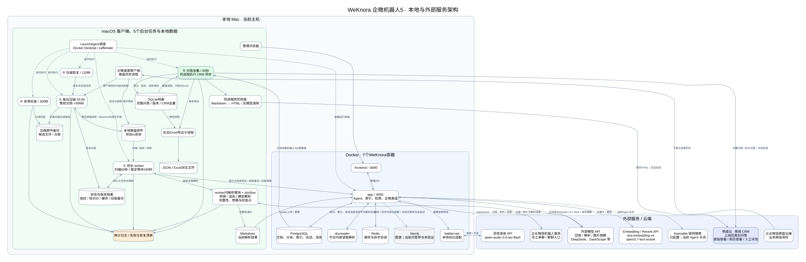

# WeKnora 企微机器人5完整架构

依据2026-10-26上午的本机服务盘点整理。实线是数据流或服务调用；虚线是调度、按需能力或明确标注的关闭/未验证关系。框图中的数据箭头描述逻辑调用，不代表每个环节本次重新端到端验收。



[打开完整SVG，可放大查看](architecture.svg) · [Mermaid源文件](architecture.mmd) · [Graphviz源文件](architecture.dot)

<details>
<summary>查看可编辑的 Mermaid 源码</summary>

```text
flowchart TB
  subgraph EXT["外部服务 / 云端"]
    WD["企业微信微盘云端<br/>业务原始资料"]
    WX["企业微信机器人服务<br/>员工单聊 / 群聊入口"]
    MODEL["外部模型 API<br/>回答 / 解析 / 图片理解<br/>DeepSeek、DashScope 等"]
    ER["Embedding / Rerank API<br/>text-embedding-v4<br/>qwen3.7-text-rerank"]
    SPEECH["百炼语音 API<br/>qwen-audio-3.0-asr-flash"]
    WEB["Keenable 联网搜索<br/>已配置；当前 Agent 关闭"]
    CRM["明道云 · 移民 CRM<br/>上线后真实问答<br/>原始答案 / 网页答案 / 人工评测"]
  end
  subgraph MAC["本地 Mac · 当前主机"]
    subgraph HOST["macOS 客户端、5个后台任务与本地数据"]
      CLIENT["企微桌面客户端<br/>微盘同步进程"]
      SOURCE[("本地微盘原件<br/>项目to咨询")]
      WORKER["① 同步 worker<br/>扫描60秒 / 稳定等待180秒"]
      PARSER["worker内解析模块 + docflow<br/>转换 / 渲染 / 模型解析<br/>完整性、预算与检查点"]
      MD[("Markdown<br/>当前解析结果")]
      STATE[("状态与版本档案<br/>指纹 / 知识ID / 缓存 / 旧版备份")]
      COMP["② 每日压缩 03:00<br/>售前文档 >30MB"]
      REC["③ 压缩恢复 / 120秒"]
      ALERT["④ 异常检查 / 300秒"]
      BACKUP[("压缩原件备份<br/>候选文件 / 台账")]
      COLLECT["⑤ 问答采集 / 60秒<br/>同进程执行 CRM 同步"]
      SQLITE[("SQLite档案<br/>完整问答 / 版本 / CRM去重")]
      FORMAT["同进程网页排版<br/>Markdown → HTML / 无模型调用"]
      EXPORT["后台Excel导出子进程"]
      FILES[("JSON / Excel派生文件")]
      LOG[("审计日志 / 失败与恢复清单")]
      OPS["LaunchAgent调度<br/>Docker Desktop / caffeinate"]
      ADMIN["管理浏览器"]
    end
    subgraph DOCKER["Docker · 7个WeKnora容器"]
      FRONT["frontend / :8090"]
      APP["app / :8091<br/>Agent、索引、检索、企微渠道"]
      DOC["docreader<br/>平台内部读取解析"]
      PG[("PostgreSQL<br/>文档、分块、索引、会话、消息")]
      REDIS[("Redis<br/>缓存与异步协调")]
      NEO[("Neo4j<br/>图谱；当前问答参与未验证")]
      ASR["bailian-asr<br/>本地协议适配"]
    end
  end
  WD -->|"下载与变更同步"| CLIENT
  CLIENT -->|"原件落地"| SOURCE
  SOURCE -->|"扫描 / 指纹 / 快照"| WORKER
  WORKER -->|"新版本需解析"| PARSER
  PARSER <-->|"页面 / 图片与解析结果"| MODEL
  PARSER -->|"完整性通过"| MD
  MD -->|"worker上传 / 更新"| APP
  WORKER <-->|"索引与检索验证 / 新版激活 / 旧版清理"| APP
  WORKER <-->|"持久化任务与映射"| STATE
  COMP -->|"先备份再生成候选"| BACKUP
  COMP <-->|"受控读取回写 / 与worker协调文件锁"| SOURCE
  CLIENT -->|"客户端身份与版本核验"| COMP
  COMP -->|"版本台账"| STATE
  REC -->|"恢复未完成任务"| COMP
  ALERT -->|"只读检查"| BACKUP
  ADMIN --> FRONT
  FRONT <-->|"管理API"| APP
  WX <-->|"WebSocket：问题、附件 / 回答"| APP
  APP <-->|"主回答deepseek-v4.1-flash / 视觉理解"| MODEL
  APP <-->|"向量化 / 重排"| ER
  APP <-->|"平台解析任务"| DOC
  APP <-->|"知识、索引、会话消息读写"| PG
  APP <-->|"缓存 / 异步任务"| REDIS
  APP -.->|"已部署；实际问答参与未验证"| NEO
  APP -.->|"按需音频转写"| ASR
  ASR <-->|"音频 / 文本"| SPEECH
  APP -.->|"当前Agent关闭"| WEB
  PG -->|"只读采集机器人5企微渠道"| COLLECT
  COLLECT -->|"原文、版本、游标保存"| SQLITE
  SQLITE -->|"直接读取，不经过Excel"| COLLECT
  COLLECT -->|"完整问答 / 执行记录；写后回读"| CRM
  COLLECT --> FORMAT
  FORMAT -->|"网页HTML；写后回读"| CRM
  COLLECT -->|"触发导出"| EXPORT
  SQLITE -->|"一致性快照"| EXPORT
  EXPORT --> FILES
  WORKER --> LOG
  PARSER --> LOG
  COMP --> LOG
  ALERT --> LOG
  COLLECT --> LOG
  OPS -.->|"启动与调度"| WORKER
  OPS -.->|"定时执行"| COLLECT
  OPS -.->|"定时执行"| COMP
  OPS -.->|"定时执行"| REC
  OPS -.->|"定时执行"| ALERT
  OPS -.->|"容器运行承载"| APP
  classDef ext fill:#eef2ff,stroke:#6366f1,color:#172554
  classDef task fill:#ecfdf5,stroke:#059669,color:#064e3b
  classDef data fill:#fff7ed,stroke:#d97706,color:#78350f
  classDef disabled fill:#f3f4f6,stroke:#9ca3af,color:#4b5563,stroke-dasharray:5 4
  class WD,WX,MODEL,ER,SPEECH,CRM ext
  class WORKER,COMP,REC,ALERT,COLLECT task
  class SOURCE,MD,STATE,BACKUP,SQLITE,FILES,LOG data
  class WEB,NEO disabled
```

</details>

## 三条主链

1. 微盘 → 客户端本地原件 → 同步与解析 → Markdown/原件入库 → 索引与检索验证 → 新版本生效。
2. 企微提问 → app内渠道 → 绑定Agent → 知识检索和文档读取 → 外部模型 → 企微回复。
3. PostgreSQL问答 → collector → SQLite → CRM原文及HTML；SQLite另行派生JSON/Excel。

资料、会话和档案主要保存在本地；模型输入、语音及CRM同步内容会发送到对应外部服务。原件更新与回答生成是两条不同链路。日志、解析、网页排版均为集成模块；OpenViking不在机器人5这条主链里。

## 配置与证据边界

- 图谱服务运行不证明每次问答使用图谱。
- 联网供应商存在不证明当前Agent已开启；当前明确关闭。
- 客户端同步核验不等同独立云端下载读回。
- 容器健康不等同真实企微回答、引用或附件验收。
- 原始执行步骤来自数据库保存的agent_steps，不补造完整内部推理。
